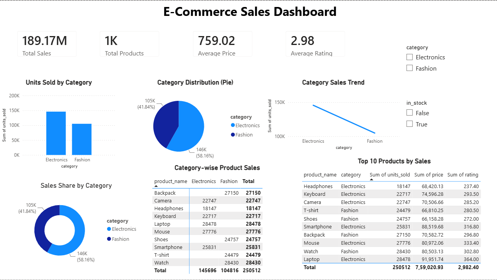

# 📊 E-Commerce Sales Dashboard

## 📌 Project Overview

This project presents an interactive E-Commerce Sales Dashboard built using Power BI. The dashboard analyzes sales performance, product categories, pricing, ratings, and product-wise sales trends to generate meaningful business insights.

---

## 📂 Dataset

- **Dataset:** E-Commerce Sales Dataset
- **Total Records:** 1000
- **Categories:** Electronics, Fashion

---

## 🛠 Tools & Technologies

- Power BI
- Python
- Pandas
- Matplotlib
- Seaborn
- Jupyter Notebook

---

## 📈 Dashboard Features

### KPI Cards
- Total Sales
- Total Products
- Average Price
- Average Rating

### Visualizations
- Units Sold by Category (Bar Chart)
- Category Distribution (Pie Chart)
- Sales Share by Category (Donut Chart)
- Category Sales Trend (Line Chart)
- Category-wise Product Sales (Matrix)
- Top 10 Products by Sales (Table)

### Interactive Filters
- Category
- In Stock

---

## 📷 Dashboard Preview



---

## 📊 Key Insights

- Electronics category generated higher sales than Fashion.
- Electronics contributed approximately **58%** of total sales.
- Fashion contributed approximately **42%** of total sales.
- The average product price is **759.02**.
- The average product rating is **2.98**.
- The dashboard highlights the **Top 10 Products by Sales**.

---

## 📁 Project Structure

```text
AP-TASK3-VISUALIZATION/
│
├── dashboards/
│   └── powerbi/
│       └── task3_dashboard.pbix
│
├── data/
│   └── cleaned/
│       └── ecommerce_dataset_cleaned.csv
│
├── notebooks/
│   └── task3_visualization.ipynb
│
├── reports/
│   └── images/
│       └── dashboard.png
│
├── visualizations/
│   ├── html/
│   │   └── category_sales_interactive.html
│   └── png/
│       ├── bar_chart_category_sales.png
│       ├── boxen_plot.png
│       ├── heatmap.png
│       ├── histogram_price.png
│       ├── line_chart_price.png
│       ├── pairplot.png
│       └── scatter_plot_price_units.png
│
├── README.md
├── requirements.txt
└── .gitignore
```

---

## 🚀 How to Run

1. Clone the repository.
2. Open `task3_dashboard.pbix` using Power BI Desktop.
3. Load the cleaned dataset if required.
4. Explore the interactive dashboard and filters.

---

## 👨‍💻 Author

**Ajay Kumar Giri**

Data Analytics Internship Project – ApexPlanet Software Pvt. Ltd.